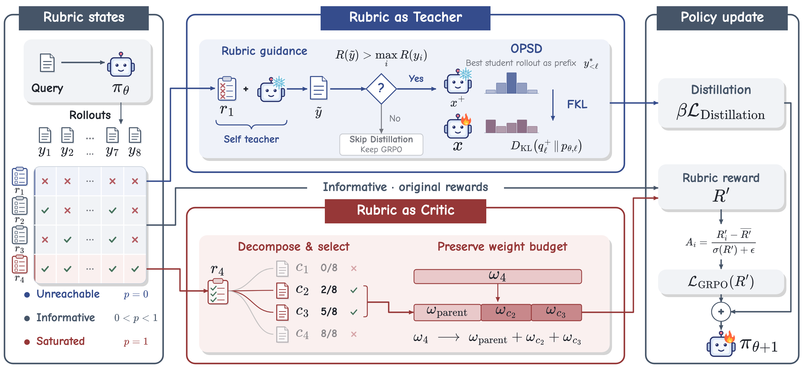
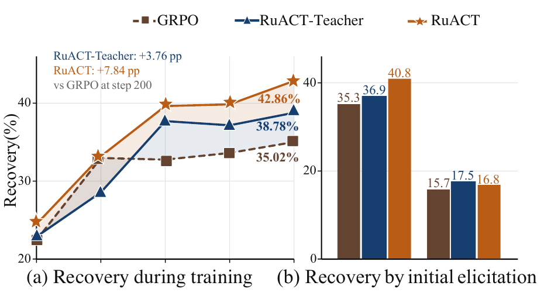
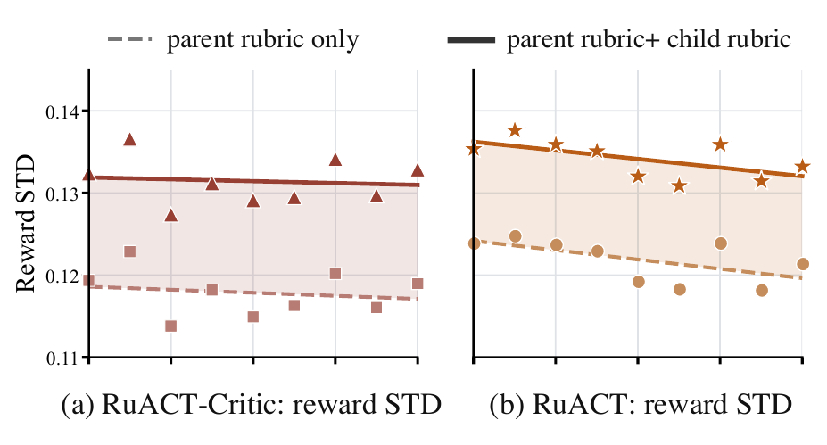
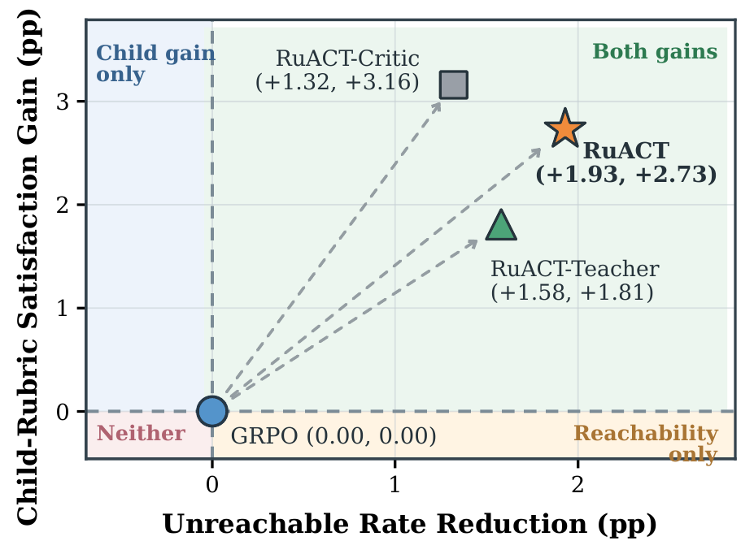

<div align="center">

# RuACT

**Recovering Inactive Rubrics as Adaptive Critics and Teachers**

[Highlights](#highlights) · [Results](#results) · [Analysis](#analysis) · [Method](#method) · [Quick start](#quick-start)

</div>

<p align="center">
  
</p>

Rubric-based reinforcement learning scores responses against query-specific requirements. A requirement that every sampled response fails or passes gives the whole group the same outcome and contributes no relative learning signal. **RuACT** recovers these inactive rubrics in two ways: a **Teacher** uses unreachable requirements as privileged guidance, and a **Critic** decomposes saturated requirements into finer criteria that distinguish the responses. The two roles train a single policy, which generates responses without privileged rubric guidance at inference time.

## News

- Training and evaluation code, experiment configurations, and paper results are available in this repository.

## Highlights

- **Two roles for inactive rubrics.** Reward-gated teacher guidance targets missing behaviors; child-rubric refinement restores distinctions among responses that pass the same parent.
- **Gains across Medicine and Science.** RuACT achieves the best average at both model scales: **47.17%** for Qwen3-1.7B and **59.12%** for Qwen3-4B across four benchmarks.
- **Recovery beyond the guided response.** On initially unreachable rubrics, unguided recovery reaches **42.86%**, compared with **35.02%** for GRPO.
- **More informative criticism.** On independent rollouts, matched child rubrics improve reward-quality alignment from **57.74%** to **60.77%**.

## Results

**Table 1.** Results from the paper's main table, in percent; higher is better. Medicine and Science use separate training runs. Except for the external OPSD* reference, evaluation uses DeepSeek-V4.1-Flash.

| Model | Group | Method | RaR-Medicine | HealthBench | RaR-Science | ResearchQA | Avg. |
|---|---|---|---:|---:|---:|---:|---:|
| Qwen3-1.7B | Vanilla | Base | 38.57 <sub>↑0.00</sub> | 23.18 <sub>↑0.00</sub> | 52.56 <sub>↑0.00</sub> | 50.51 <sub>↑0.00</sub> | 41.21 <sub>↑0.00</sub> |
| Qwen3-1.7B | Baselines | GRPO | 43.26 <sub>↑4.69</sub> | 26.45 <sub>↑3.27</sub> | 55.67 <sub>↑3.11</sub> | 54.79 <sub>↑4.28</sub> | 45.04 <sub>↑3.84</sub> |
| Qwen3-1.7B | Baselines | Reweight | 42.60 <sub>↑4.03</sub> | 25.61 <sub>↑2.43</sub> | 56.77 <sub>↑4.21</sub> | 56.11 <sub>↑5.60</sub> | 45.27 <sub>↑4.07</sub> |
| Qwen3-1.7B | Baselines | RuscaRL | <ins>43.39</ins> <sub>↑4.82</sub> | 23.95 <sub>↑0.77</sub> | 56.41 <sub>↑3.85</sub> | **59.37** <sub>↑8.86</sub> | 45.78 <sub>↑4.58</sub> |
| Qwen3-1.7B | Baselines | OPSD\* | 26.30 | 38.50 | 39.60 | 38.40 | 35.70 |
| Qwen3-1.7B | Ours | RuACT-Teacher | **43.82** <sub>↑5.25</sub> | 25.16 <sub>↑1.98</sub> | <ins>58.42</ins> <sub>↑5.86</sub> | 57.76 <sub>↑7.25</sub> | 46.29 <sub>↑5.09</sub> |
| Qwen3-1.7B | Ours | RuACT-Critic | 43.24 <sub>↑4.67</sub> | **27.97** <sub>↑4.79</sub> | 58.16 <sub>↑5.60</sub> | 58.55 <sub>↑8.04</sub> | <ins>46.98</ins> <sub>↑5.77</sub> |
| Qwen3-1.7B | Ours | **RuACT** | 43.35 <sub>↑4.78</sub> | <ins>27.83</ins> <sub>↑4.65</sub> | **58.83** <sub>↑6.27</sub> | <ins>58.65</ins> <sub>↑8.14</sub> | **47.17** <sub>↑5.96</sub> |
| Qwen3-4B | Vanilla | Base | 50.38 <sub>↑0.00</sub> | 35.45 <sub>↑0.00</sub> | 66.16 <sub>↑0.00</sub> | 59.16 <sub>↑0.00</sub> | 52.79 <sub>↑0.00</sub> |
| Qwen3-4B | Baselines | GRPO | 53.55 <sub>↑3.17</sub> | 37.62 <sub>↑2.17</sub> | 70.08 <sub>↑3.92</sub> | 64.82 <sub>↑5.66</sub> | 56.52 <sub>↑3.73</sub> |
| Qwen3-4B | Baselines | Reweight | 55.34 <sub>↑4.96</sub> | 38.46 <sub>↑3.01</sub> | 70.28 <sub>↑4.12</sub> | 65.02 <sub>↑5.86</sub> | 57.28 <sub>↑4.49</sub> |
| Qwen3-4B | Baselines | RuscaRL | 55.36 <sub>↑4.98</sub> | 37.10 <sub>↑1.65</sub> | 69.38 <sub>↑3.22</sub> | 65.33 <sub>↑6.17</sub> | 56.79 <sub>↑4.01</sub> |
| Qwen3-4B | Baselines | OPSD\* | 42.00 | 42.10 | 38.30 | 45.20 | 41.90 |
| Qwen3-4B | Ours | RuACT-Teacher | 55.15 <sub>↑4.77</sub> | 38.57 <sub>↑3.12</sub> | <ins>70.53</ins> <sub>↑4.37</sub> | <ins>66.12</ins> <sub>↑6.96</sub> | <ins>57.59</ins> <sub>↑4.81</sub> |
| Qwen3-4B | Ours | RuACT-Critic | <ins>55.50</ins> <sub>↑5.12</sub> | <ins>38.77</ins> <sub>↑3.32</sub> | 70.47 <sub>↑4.31</sub> | 64.62 <sub>↑5.46</sub> | 57.34 <sub>↑4.55</sub> |
| Qwen3-4B | Ours | **RuACT** | **56.34** <sub>↑5.96</sub> | **40.12** <sub>↑4.67</sub> | **70.59** <sub>↑4.43</sub> | **69.44** <sub>↑10.28</sub> | **59.12** <sub>↑6.34</sub> |

Avg. is the unweighted mean of the four benchmark scores. Arrows show absolute gains over the corresponding base model, in percentage points. Scores and gains reproduce the paper at its reported precision. **Bold** and <ins>underlined</ins> scores mark the best and second-best matched results within each model scale.

OPSD* is an external reference quoted from CriPO, which uses filtered RaR splits and GPT-4o-mini as its evaluation judge. It is excluded from matched-result highlighting and gain annotations. It is distinct from the GRPO-OPSD analysis recipe in this repository.

[Table data](analysis/data/checkpoint_scores.csv) · [Source and analysis notes](analysis/README.md)

## Analysis

### Recovering unreachable rubrics

<p align="center">
  
</p>

**Figure 4.** Qwen3-4B on RaR-Medicine. A fixed cohort contains **931 initially unreachable rubrics from 331 training queries**. Recovery means that at least one of eight unguided responses satisfies the rubric. At step 200, RuACT-Teacher and RuACT improve on GRPO by **3.76** and **7.84 percentage points**, respectively. The right panel groups rubrics by whether guidance can elicit the behavior from the base model.

### Critic discrimination and quality alignment

<p align="center">
  
</p>

**Figure 5.** Responses are sampled independently of those used to select child rubrics. Refinement increases within-group reward standard deviation by **11.34%** for RuACT-Critic and **10.02%** for RuACT. The quality-alignment comparison below checks whether that extra variation agrees with independent judgments of response quality.

**Table 2.** Blind quality judgments on **300 rollout groups (2,400 responses)**. Both metrics are percentages; higher is better.

| Scoring rule | Quality alignment | Reward coverage |
|---|---:|---:|
| Parent rubric only | 57.74 | 65.92 |
| With decomposed rubrics | **60.77** | 88.85 |
| With shuffled decomposed rubrics | 53.62 | **90.44** |

Matched children improve alignment by **3.03 points**. Shuffling raises coverage but lowers alignment, showing why reward variation alone is insufficient.

### Joint gains from Teacher and Critic

<p align="center">
  
</p>

**Figure 6.** The horizontal axis measures unreachable-rate reduction over **21,500 test query-rubric pairs**; the vertical axis measures child-rubric satisfaction gains on **1,954 fixed Base-saturated parents** with shared children. Both are percentage-point improvements over GRPO. RuACT achieves the largest unreachable-rate reduction (**1.93 points**) while retaining a **2.73-point** gain in child satisfaction.

### Alternative optimization strategies

**Table 3.** Qwen3-4B on Medicine. Scores are percentages; arrows report gains over Base.

| Method | RaR-Medicine | HealthBench | Avg. |
|---|---:|---:|---:|
| Base | 50.38 <sub>↑0.00</sub> | 35.45 <sub>↑0.00</sub> | 42.92 <sub>↑0.00</sub> |
| GRPO | 53.55 <sub>↑3.17</sub> | 37.62 <sub>↑2.17</sub> | 45.59 <sub>↑2.67</sub> |
| DAPO-style | 56.29 <sub>↑5.91</sub> | 39.27 <sub>↑3.82</sub> | 47.78 <sub>↑4.87</sub> |
| GRPO+OPSD | 55.59 <sub>↑5.21</sub> | 38.63 <sub>↑3.18</sub> | 47.11 <sub>↑4.20</sub> |
| OPSD\* | 42.00 | 42.10 | 42.05 |
| **RuACT** | **56.34** <sub>↑5.96</sub> | **40.12** <sub>↑4.67</sub> | **48.23** <sub>↑5.32</sub> |

OPSD* is the external CriPO reference described above. DAPO-style adapts dynamic sampling to rubric-based GRPO; GRPO+OPSD is the locally evaluated distillation baseline.

### General capability preservation

**Table 4.** Medicine-trained checkpoints evaluated with Qwen3-Max. MT-Bench scores range from 0 to 10; FollowBench reports hard and soft success rates (HSR and SSR) in percent.

| Model | Method | MT-Bench R1 | MT-Bench R2 | FollowBench HSR | FollowBench SSR |
|---|---|---:|---:|---:|---:|
| Qwen3-1.7B | Base | 7.13 | 5.90 | 43.52 | 56.44 |
| Qwen3-1.7B | **RuACT** | **7.66** | **6.03** | **45.37** | **57.69** |
| Qwen3-4B | Base | 8.31 | 7.60 | 58.50 | 67.28 |
| Qwen3-4B | **RuACT** | **8.64** | **7.88** | **59.89** | **67.75** |

### Ablations

**Table 5.** Qwen3-4B on Medicine. Avg. is the unweighted mean of the two benchmark scores.

| Component | Variant | RaR-Medicine | HealthBench | Avg. |
|---|---|---:|---:|---:|
| Combined | **RuACT** | **56.34** | **40.12** | **48.23** |
| Teacher | RuACT-Teacher | 55.15 | 38.57 | 46.86 |
| Teacher | Without gate | 55.18 | 37.45 | 46.32 |
| Critic | RuACT-Critic | 55.50 | 38.77 | 47.14 |
| Critic | Without filter | 54.99 | 38.50 | 46.75 |

Removing the Teacher gate lowers the two-benchmark average by **0.54 points**; removing the Critic filter lowers it by **0.39 points**. Neither component alone matches combined RuACT.

### Critic case study

**Table 10. Query:** Which muscles are specifically involved in the process of expiration?

| Criterion | Requirement | Passing responses |
|---|---|---:|
| Parent | Explains that abdominal muscles contract to increase intra-abdominal pressure during active expiration. | 8 / 8 |
| Child 1 | External oblique contraction increases abdominal pressure during forced exhalation. | 2 / 8 |
| Child 2 | Internal oblique helps compress the abdomen during active expiration. | 4 / 8 |
| Child 3 | Transversus abdominis compresses abdominal contents to raise intra-abdominal pressure. | 4 / 8 |

<details>
<summary>Judgments for the eight responses</summary>

| Response | Parent | Child 1 | Child 2 | Child 3 |
|---|---:|---:|---:|---:|
| R1 | 1 | 0 | 1 | 1 |
| R2 | 1 | 0 | 0 | 0 |
| R3 | 1 | 1 | 1 | 1 |
| R4 | 1 | 0 | 1 | 1 |
| R5 | 1 | 0 | 0 | 0 |
| R6 | 1 | 1 | 1 | 1 |
| R7 | 1 | 0 | 0 | 0 |
| R8 | 1 | 0 | 0 | 0 |

These are the stored judge verdicts reported in the paper: 1 means satisfied and 0 means not satisfied. [Response excerpts and exact criterion wording](analysis/data/critic_case.json).

</details>

Figures 4-6 are direct excerpts from the paper. Table values and source locations are provided in [analysis/](analysis/README.md).

## Method

RuACT assigns a role according to a rubric's pass rate within the current rollout group.

| Component | Target | Training signal |
|---|---|---|
| **RuACT-Teacher** | Unreachable rubrics: all responses fail | Add the rubric as privileged guidance, gate the guided response by aggregate reward, and distill the teacher distribution on the student's response prefix. |
| **RuACT-Critic** | Saturated positive rubrics: all responses pass | Generate finer child criteria, retain those that distinguish the sampled responses, and share the parent's weight among its children. |
| **RuACT** | Both types | Combine Teacher distillation with Critic-refined rewards in one policy update. |

The standard Critic proposes **five candidates** per selected parent. It retains candidates passed by **2-6 of the eight responses** and keeps at most **three children per parent**, with at most **three selected parents per query**. If too few children survive, it makes **at most one additional generation round using the filtering feedback**. This is separate from retrying a failed service request. An optional semantic meta-judge can validate the children; its use is recorded explicitly in the audit.

Standalone Teacher/Critic and combined RuACT share their implementations. Teacher coefficients are **0.1 for 1.7B** and **0.05 for 4B**; the Critic blend coefficient is **0.5**. See the [training guide](docs/training.md) for the objective, gate, filtering policy, and baseline definitions.

## Quick start

```bash
git clone https://github.com/ZJU-REAL/RuACT.git
cd RuACT
```

Install a CUDA-compatible PyTorch, vLLM and FlashAttention environment, then install the checkout:

```bash
pip install -e .
```

Prepare the training and validation Parquet files as described in [data/README.md](data/README.md). Copy the local configuration template and fill in model, dataset, output, frozen candidate library, GPU and service settings:

```bash
cp configs/local.example.json settings.local.json
bash experiments/main/medicine/4b/RuACT.sh --settings settings.local.json --dry-run
bash experiments/main/medicine/4b/RuACT.sh --settings settings.local.json
```

The dry run prints the effective configuration with credentials removed and makes no model requests. A real run saves `resolved-config.json` in its output directory. API authentication may be supplied by environment variables; populated local settings are excluded from Git. Fresh training requires an empty output directory.

Other experiment groups use the same launcher and framework:

```bash
bash experiments/main/science/1.7b/RuACT-Critic.sh --settings settings.local.json
bash experiments/baselines/medicine/4b/Reweight.sh --settings settings.local.json
bash experiments/analysis/medicine/4b/no-filter.sh --settings settings.local.json
```

| Group | Entries |
|---|---|
| Main experiments | GRPO, RuACT-Teacher, RuACT-Critic, RuACT; Medicine/Science × 1.7B/4B |
| Baselines | GRPO, Reweight, RuscaRL; the two GRPO entrypoints resolve identically |
| Analysis | GRPO-OPSD, DAPO-style, no-gate, no-filter, and normal/reversed target selectors; Medicine-4B |

Reweight is a rubric-reweighting implementation inspired by prior work, not a full reproduction of another system. DAPO-style implements group filtering and refill, not the complete DAPO method. Exact definitions are in the [training guide](docs/training.md).

### Shared defaults

| Setting | Value |
|---|---|
| Optimizer updates / responses per query | 200 / 8 |
| Batch / PPO mini-batch | 64 / 32 |
| Learning rate / actor KL coefficient | 1e-6 / 0.001 |
| Prompt / response / total context limits | 1,024 / 4,096 / 6,144 tokens |
| Checkpoint and validation interval | 20 updates |
| Teacher target coefficient | 0.1 at 1.7B; 0.05 at 4B |
| Critic blend coefficient | 0.5 |
| Critic candidates / additional generation rounds | 5 / at most 1 |
| Selected parents per query / children per parent | at most 3 / at most 3 |

The internal Teacher coefficient is divided by the eight-response group size. Per-method memory, micro-batch and context differences are explicit in [configs/training.json](configs/training.json).

### Evaluation

Generate frozen responses, verify their identity and coverage, then score and aggregate using the explicit rubric weights. Commands and required service variables are in [docs/evaluation.md](docs/evaluation.md). The scorer preserves rubric order and records judge attempts and rollout length-termination flags.

### Method checks

```bash
pip install -e '.[test]'
pytest -q
```

The focused CPU tests check Teacher, Critic, reward and baseline behavior with fixed judge responses. GPU training and benchmark evaluation use the launchers above and the [evaluation guide](docs/evaluation.md).

## Repository layout

| Path | Contents |
|---|---|
| [ruact/teacher/](ruact/teacher/) | Unreachable-rubric selection, reward gate, and teacher distillation. |
| [ruact/critic/](ruact/critic/) | Child generation, filtering, feedback regeneration, and optional semantic validation. |
| [ruact/baselines/](ruact/baselines/) | Reweight and RuscaRL implementations. |
| [ruact/reward.py](ruact/reward.py) | Rubric reward aggregation; shared judge and training adapters live alongside it. |
| [verl/](verl/) | One shared distributed training runtime with the RuACT integrations. |
| [configs/](configs/) | Training defaults, model/domain profiles, Critic settings, and local service templates. |
| [experiments/main/](experiments/main/) | GRPO, RuACT-Teacher, RuACT-Critic, and RuACT for Medicine/Science at 1.7B/4B. |
| [experiments/baselines/](experiments/baselines/) | GRPO, Reweight, and RuscaRL launch scripts. |
| [experiments/analysis/](experiments/analysis/) | Medicine-4B ablations and alternative optimization recipes. |
| [experiments/train.py](experiments/train.py) | Common configuration resolver and launcher. |
| [evaluation/](evaluation/) | Rollout generation, identity checks, rubric scoring, and aggregation. |
| [data/](data/README.md) | Dataset schema and preparation utility. |
| [analysis/](analysis/README.md) | Paper table data, Critic case records, and figure provenance. |
| [assets/](assets/) | Method overview and original paper figure excerpts. |
| [docs/](docs/) | Training and evaluation instructions. |
| [tests/](tests/) | Focused checks for the method's branches and numerical invariants. |

DeepRubric is covered by the data contract; a verified DeepRubric-7B training recipe is not included in this release. The project uses the [Apache-2.0 license](LICENSE); upstream attribution is retained in [THIRD_PARTY_NOTICES.txt](THIRD_PARTY_NOTICES.txt).
